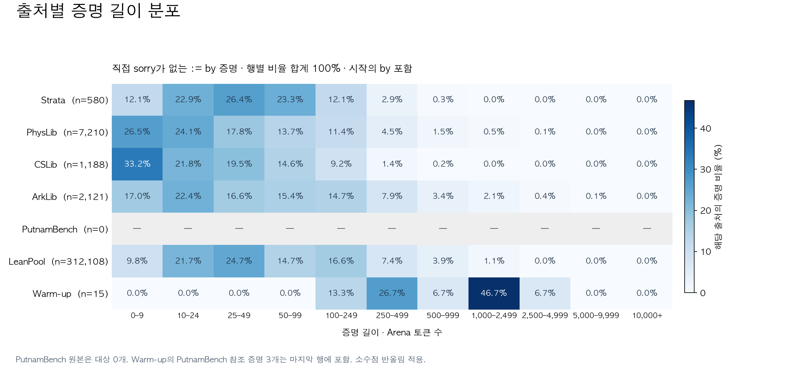
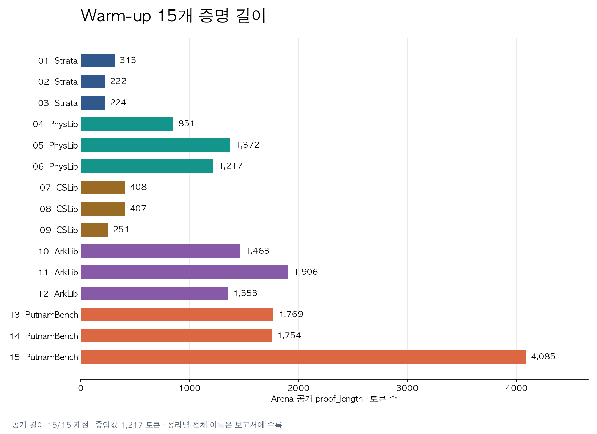

# Arena 기준 증명 길이 분포

주 분포: 추출한 `:= by` 형태 정리 중 직접 `sorry/admit`가 없는 증명. 단위는 Arena 토큰 수이며 `:=`는 제외하고 시작의 `by`는 포함한다. 줄 수·문자 수·LLM 토큰 수와 다르다. 주석은 제외한다.

Arena warm-up 공개 길이 **15/15 일치**를 기준으로 사용했다. 명제·선언부는 이미 추출한 정확한 경계로 제외한다. 새 증명의 값은 로컬 재현값이며 Arena 서버 재평가 값은 아니다.



| 출처 | 대상 수 | 중앙값 | 평균 | P90 | P99 | 최대 |
| --- | ---: | ---: | ---: | ---: | ---: | ---: |
| Strata | 580 | 39 | 61.4 | 138 | 415.1 | 667 |
| PhysLib | 7,210 | 24 | 74.8 | 174.1 | 802.4 | 6,047 |
| CSLib | 1,188 | 20 | 41.8 | 106.6 | 331.4 | 623 |
| ArkLib | 2,121 | 38 | 144.2 | 325 | 1,741.2 | 5,538 |
| PutnamBench | 0 | — | — | — | — | — |
| LeanPool | 312,108 | 38 | 120 | 307 | 1,076 | 4,007 |
| Warm-up 15 | 15 | 1,217 | 1,173 | 1,851.2 | 3,779.9 | 4,085 |

P90은 90%의 증명이 그 길이 이하인 지점을 선형 보간한 값이다. 출처별 비율로 비교하며, 규모가 큰 LeanPool을 합산해 다른 출처의 분포를 덮지 않는다.

## Warm-up 15개



| 번호 | 출처 | 정리 | 토큰 수 | 해당 출처 내 누적 백분위 |
| ---: | --- | --- | ---: | ---: |
| 1 | Strata | `CallElimCorrect.substOldPostSubset` | 313 | 97.9% |
| 2 | Strata | `CallElimCorrect.extractedOldExprInVars` | 222 | 95.9% |
| 3 | Strata | `Core.InitsUpdatesComm` | 224 | 96% |
| 4 | PhysLib | `fundamental_theorem_of_variational_calculus'` | 851 | 99.1% |
| 5 | PhysLib | `Electromagnetism.ElectromagneticPotential.time_deriv_time_deriv_electricField_of_isExtrema` | 1,372 | 99.7% |
| 6 | PhysLib | `FieldSpecification.WickAlgebra.ι_timeOrderF_superCommuteF_eq_time` | 1,217 | 99.7% |
| 7 | CSLib | `Cslib.LambdaCalculus.LocallyNameless.Fsub.Typing.progress` | 408 | 99.6% |
| 8 | CSLib | `Cslib.SKI.parallelReduction_diamond` | 407 | 99.5% |
| 9 | CSLib | `Cslib.CCS.bisimilarity_congr_choice` | 251 | 98.5% |
| 10 | ArkLib | `Binius.BinaryBasefold.fiberwise_dist_lt_imp_dist_lt_unique_decoding_radius` | 1,463 | 98.6% |
| 11 | ArkLib | `Binius.BinaryBasefold.fold_advances_evaluation_poly` | 1,906 | 99.2% |
| 12 | ArkLib | `interleaved_affine_gaps_imply_tensor_gaps` | 1,353 | 98.3% |
| 13 | PutnamBench | `putnam_1964_a4` | 1,769 | — |
| 14 | PutnamBench | `putnam_1964_b2` | 1,754 | — |
| 15 | PutnamBench | `putnam_1995_a3` | 4,085 | — |

백분위는 같은 출처의 주 분포에서 warm-up 길이 이하인 증명의 비율이다. PutnamBench는 완성 증명 분모가 없어 비교하지 않는다. Warm-up은 선택된 예제 15개로, 무작위 표본이나 본 대회 전체 분포가 아니다.

## 포함·제외 범위

| 출처 | 전체 정리 | by 전체 | by 직접 sorry | 주 분포 | term 직접 sorry 제외 | 방정식·구조체 등 |
| --- | ---: | ---: | ---: | ---: | ---: | ---: |
| Strata | 615 | 589 | 9 | 580 | 23 | 3 |
| PhysLib | 9,008 | 7,226 | 16 | 7,210 | 1,608 | 173 |
| CSLib | 1,692 | 1,188 | 0 | 1,188 | 441 | 63 |
| ArkLib | 2,686 | 2,219 | 98 | 2,121 | 440 | 17 |
| PutnamBench | 672 | 10 | 10 | 0 | 0 | 0 |
| LeanPool | 367,448 | 312,108 | 0 | 312,108 | 53,964 | 1,376 |

- `summary.json`에는 주 분포 외에 sorry 포함 by 전체, term, 대입형 전체 분포도 별도로 제공한다. `lengths.jsonl.gz`는 대입형 정리별 길이와 proof SHA다. 원본 코퍼스는 수정하지 않았다.
- PutnamBench 원본 672개는 모두 sorry를 포함한다. 원본의 빈 분포를 길이 0으로 표시하지 않는다. warm-up PutnamBench 3개는 별도의 완성된 참조 증명이다.
- 직접 sorry 제외는 커널·공리 검증 완료를 뜻하지 않는다. 중복 증명을 제거하지 않았으며, 길이가 heartbeat 비용을 뜻하지 않는다.
- 출처마다 Lean 버전과 추출 방식이 다르다. 기준 커밋과 파싱 한계는 [여섯 출처 비교](../all_sources/report.md)를 참조한다.

## 계산 기준 검증

[저자 공개 proof_length 코드](https://github.com/delta-lab-ai/lean-refactor/blob/main/lean_refactor/utils.py)의 lexer와 같은 토큰화 규칙을 사용한다. 공개 함수 전체를 그대로 적용하면 14/15만 일치한다. Warm-up 11번 명제 내부 `let P_i :=`를 증명 시작으로 잡아 2,219를 반환하지만, 공개 benchmark 값은 1,906이다. 정확한 statement 경계를 사용하는 기존 `scripts/proof_tokens.py`는 15/15를 재현한다. 두 결과를 summary의 calibration에 모두 보존했다.

재계산한 모든 대입형 길이와 기존 inventory의 proof_length가 일치함을 검사했다. 공개 코드 스냅샷·해시는 `data/proof_length_reference/`에 저장했다. 순위 통계와 빈 구간 처리는 단위 테스트로 검사했다.

```bash
source /Users/jwkweon/00_work/00_project/env/use.sh 05_pseudolab/LeanAgent-LeanRefactorArena
/Users/jwkweon/00_work/00_project/env/05_pseudolab/LeanAgent-LeanRefactorArena/.venv/bin/python scripts/proof_length_distribution.py
```
