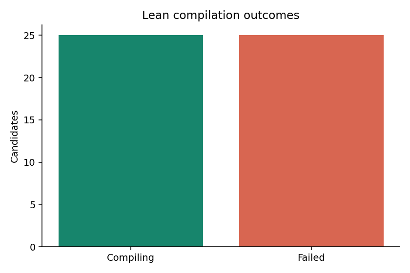
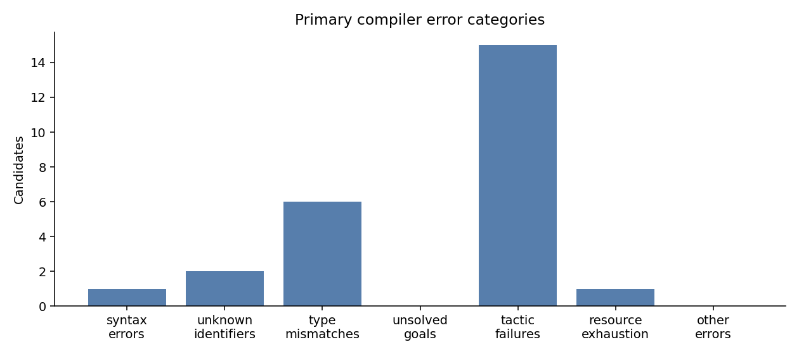
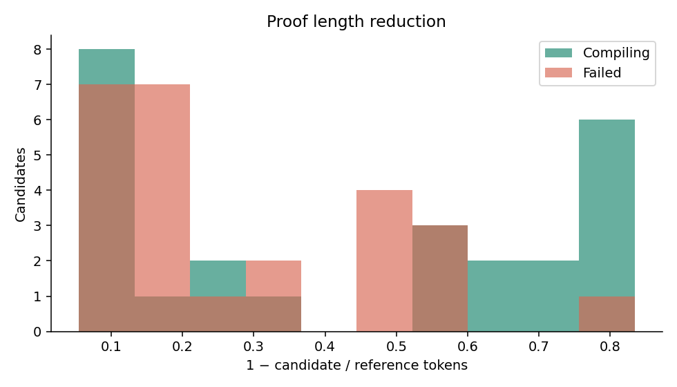
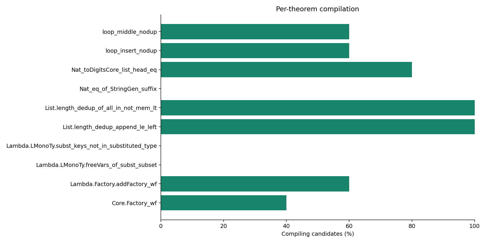

# Strata synthetic proof dataset

Generated **50** first-attempt candidates: **25** compiling (50.0%), **25** failed (50.0%).
Safety violations: 0. Exact duplicate attempts beyond the first: 0.

All reference proofs were compiled first. The 15-candidate pilot preceded the remaining 35 candidates. Failures and duplicates were retained without retries or repairs.

## Measurement limits

Generation used the user-authorized shared Codex session, with five fixed refactoring objectives. These are separate first-response attempts, but they are **not statistically independent API samples**. The exact model deployment, temperature, seed, prompt/completion API tokens, and heartbeat usage are unavailable (null). No costs are estimated. Lexical proof tokens use the pinned upstream Arena tokenizer, not LLM tokens. Compilation success and safety are separate labels. For noncompiling proofs, safety records lexical checks; transitive axiom status is unavailable. This small, shortest-eligible-first sample is not representative of all Strata.

## Error distribution

| Category | Count |
|---|---:|
| syntax_errors | 1 |
| unknown_identifiers | 2 |
| type_mismatches | 6 |
| unsolved_goals | 0 |
| tactic_failures | 15 |
| resource_exhaustion | 1 |
| other_errors | 0 |

Categories come from actual compiler diagnostics. Precedence: resource exhaustion, syntax, unknown identifiers, type mismatches, unsolved goals, tactic failures, other. A candidate with several diagnostics receives one primary label; raw logs permit reclassification.

## Proof lengths

Reduction = 1 − candidate/reference. Standard deviation is population standard deviation. Reference lengths below are weighted by candidate attempts.

| Group | Metric | Mean | Median | Std. dev. | Min | Max |
|---|---|---:|---:|---:|---:|---:|
| all | reference_token_count | 229.6000 | 197.5000 | 79.6445 | 119.0000 | 392.0000 |
| all | candidate_token_count | 135.4400 | 119.0000 | 63.3189 | 33.0000 | 299.0000 |
| all | length_reduction_ratio | 0.3633 | 0.2536 | 0.2710 | 0.0545 | 0.8342 |
| compiling | reference_token_count | 235.7200 | 199.0000 | 80.6025 | 119.0000 | 392.0000 |
| compiling | candidate_token_count | 115.0000 | 121.0000 | 47.1355 | 33.0000 | 190.0000 |
| compiling | length_reduction_ratio | 0.4432 | 0.5607 | 0.2992 | 0.0615 | 0.8342 |
| failing | reference_token_count | 223.4800 | 196.0000 | 78.1972 | 119.0000 | 392.0000 |
| failing | candidate_token_count | 155.8800 | 117.0000 | 70.4360 | 75.0000 | 299.0000 |
| failing | length_reduction_ratio | 0.2835 | 0.1775 | 0.2113 | 0.0545 | 0.8087 |

## Theorems

| Theorem | Candidates | Compile rate | Unique | Mean reduction |
|---|---:|---:|---:|---:|
| Core.Factory_wf | 5 | 40% | 5 | 0.0908 |
| Lambda.Factory.addFactory_wf | 5 | 60% | 5 | 0.1050 |
| Lambda.LMonoTy.freeVars_of_subst_subset | 5 | 0% | 5 | 0.3799 |
| Lambda.LMonoTy.subst_keys_not_in_substituted_type | 5 | 0% | 5 | 0.1818 |
| List.length_dedup_append_le_left | 5 | 100% | 5 | 0.5264 |
| List.length_dedup_of_all_in_not_mem_lt | 5 | 100% | 5 | 0.7508 |
| Nat_eq_of_StringGen_suffix | 5 | 0% | 5 | 0.1734 |
| Nat_toDigitsCore_list_head_eq | 5 | 80% | 5 | 0.8102 |
| loop_insert_nodup | 5 | 60% | 5 | 0.3344 |
| loop_middle_nodup | 5 | 60% | 5 | 0.2806 |

## Charts

